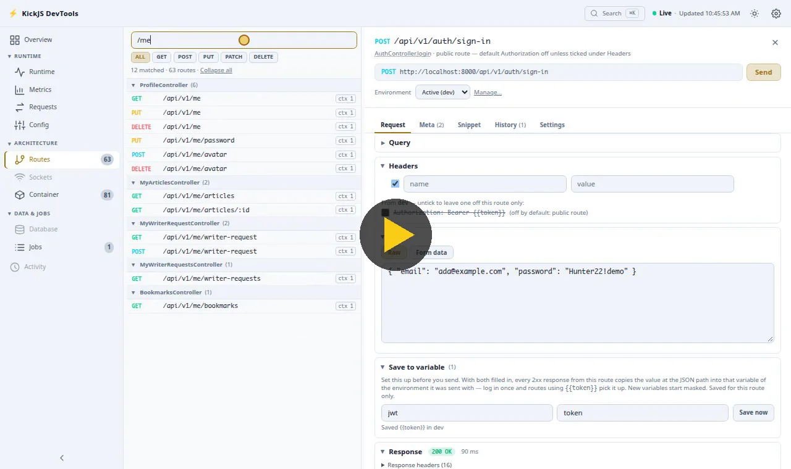

<p align="center">
  <a href="https://kickjs.app/">
    
  </a>
</p>

<p align="center">
  Modern type-safe backend framework, powered by Vite.<br />
  Built for developer experience. Pluggable as you need.
</p>

<p align="center">
  <a href="https://www.npmjs.com/package/@forinda/kickjs"></a>
  <a href="https://www.npmjs.com/package/@forinda/kickjs"></a>
  <a href="https://github.com/forinda/kick-js/actions/workflows/ci.yml"></a>
  <a href="https://www.npmjs.com/package/@forinda/kickjs"></a>
  <a href="https://github.com/forinda/kick-js/blob/main/LICENSE"></a>
  <a href="https://nodejs.org"></a>
  <a href="https://github.com/forinda/kick-js"></a>
</p>

NestJS ergonomics without the complexity: decorators, DI, modules, code generators, and end-to-end type safety.

## Install

```bash
pnpm add @forinda/kickjs express reflect-metadata zod
pnpm add -D @forinda/kickjs-cli
```

Or scaffold a new project:

```bash
npx @forinda/kickjs-cli new my-api
cd my-api && npm run dev   # or pnpm dev / yarn dev / bun run dev, for the package manager you picked
```

Or a fullstack workspace — KickJS API + Vite/React frontend, typed end to end:

```bash
pnpm dlx @forinda/kickjs-cli new my-app --template fullstack --pm pnpm
cd my-app && pnpm dev   # server + web in parallel; rename a server field and the frontend stops compiling
```

With npm, yarn or bun, run `dev:server` and `dev:web` in two terminals instead (`npm run dev:server`).

## Hello World

```ts
// src/modules/hello/hello.controller.ts
import { Controller, Get, type Ctx } from '@forinda/kickjs'

@Controller()
export class HelloController {
  @Get('/')
  index(ctx: Ctx<KickRoutes.HelloController['index']>) {
    return { message: 'Hello from KickJS!' } // sent as JSON; type flows to the typed client
  }
}
```

```ts
// src/modules/hello/hello.module.ts
import { defineModule } from '@forinda/kickjs'
import { HelloController } from './hello.controller'

export const HelloModule = defineModule({
  name: 'HelloModule',
  build: () => ({
    routes: () => ({ path: '/hello', controller: HelloController }),
  }),
})
```

```ts
// src/index.ts
import 'reflect-metadata'
import './config' // registers env schema before bootstrap
import { bootstrap, defineModules } from '@forinda/kickjs'
import { HelloModule } from './modules/hello/hello.module'

export const app = await bootstrap({ modules: defineModules().mount(HelloModule()) })
```

`KickRoutes` is generated by `kick typegen` (runs automatically on `kick dev`). `GET /health/live` and `/health/ready` are mounted for you.

## Highlights

- **Pluggable engine** — Express, Fastify, or h3 via `bootstrap({ runtime })`; the same app runs on Workers, Bun, and Deno through [`@forinda/kickjs/web`](https://kickjs.app/guide/edge-deployment.html).
- **DI container** — constructor and property injection, singleton / transient / request scopes, no external dependency.
- **End-to-end types** — `kick typegen` types `ctx.params/body/query`, env keys, and responses; [`@forinda/kickjs-client`](packages/client/) calls your API with the server's types.
- **Context contributors** — `defineHttpContextDecorator()` populates `ctx` with typed, ordered values instead of ad-hoc middleware.
- **Route flags** — `defineRouteFlag()` declares per-route policy (e.g. a `@Public` flag) once; auth, CSRF, rate limiting, and OpenAPI all read it.
- **Batteries** — helmet, CORS, CSRF, rate limiting, uploads, request logging, OpenAPI, and a `/_debug` [DevTools dashboard](https://kickjs.app/guide/devtools.html) — routes with an API runner, DI, requests, jobs and metrics:

  [](https://kickjs.app/guide/devtools.html)

- **Vite HMR** — single-port dev server that keeps DB and socket connections across reloads.
- **Generators** — `kick g module users` scaffolds a full module; `kick g agents` keeps AI-agent docs in sync.

## Packages

Every project gets [`@forinda/kickjs`](packages/kickjs/) (the framework), [`@forinda/kickjs-vite`](packages/vite/) (dev server + typegen watcher), and [`@forinda/kickjs-cli`](packages/cli/). Everything else (swagger, db, queue, ws, devtools, ai, grpc, mcp, …) installs on demand:

```bash
kick add --list      # optional packages
kick add swagger pg  # install with peer deps
```

| Package                                                                  | What it is                                                                | Version                                                                                                                                                             | Weekly downloads                                                                                                                                                           |
| ------------------------------------------------------------------------ | ------------------------------------------------------------------------- | ------------------------------------------------------------------------------------------------------------------------------------------------------------------- | -------------------------------------------------------------------------------------------------------------------------------------------------------------------------- |
| [`@forinda/kickjs`](packages/kickjs/)                                    | The framework: DI, decorators, HTTP on Express, Fastify or h3             | [](https://www.npmjs.com/package/@forinda/kickjs)                                           | [](https://www.npmjs.com/package/@forinda/kickjs)                                           |
| [`@forinda/kickjs-cli`](packages/cli/)                                   | `kick` CLI: scaffolding, generators, dev/build/start, typegen             | [](https://www.npmjs.com/package/@forinda/kickjs-cli)                                   | [](https://www.npmjs.com/package/@forinda/kickjs-cli)                                   |
| [`@forinda/kickjs-vite`](packages/vite/)                                 | Vite plugin: dev server, HMR, typegen watcher                             | [](https://www.npmjs.com/package/@forinda/kickjs-vite)                                 | [](https://www.npmjs.com/package/@forinda/kickjs-vite)                                 |
| [`@forinda/kickjs-di`](packages/di/)                                     | The DI container, usable on its own                                       | [](https://www.npmjs.com/package/@forinda/kickjs-di)                                     | [](https://www.npmjs.com/package/@forinda/kickjs-di)                                     |
| [`@forinda/kickjs-schema`](packages/schema/)                             | Validation over Zod, Valibot, Yup or any Standard Schema                  | [](https://www.npmjs.com/package/@forinda/kickjs-schema)                             | [](https://www.npmjs.com/package/@forinda/kickjs-schema)                             |
| [`@forinda/kickjs-client`](packages/client/)                             | Typed fetch client for your API routes                                    | [](https://www.npmjs.com/package/@forinda/kickjs-client)                             | [](https://www.npmjs.com/package/@forinda/kickjs-client)                             |
| [`@forinda/kickjs-testing`](packages/testing/)                           | `createTestApp`, `createTestModule`, test helpers                         | [](https://www.npmjs.com/package/@forinda/kickjs-testing)                           | [](https://www.npmjs.com/package/@forinda/kickjs-testing)                           |
| [`@forinda/kickjs-db`](packages/db/)                                     | kick/db: code-first schema, migrations, query builder (pg, mysql, sqlite) | [](https://www.npmjs.com/package/@forinda/kickjs-db)                                     | [](https://www.npmjs.com/package/@forinda/kickjs-db)                                     |
| [`@forinda/kickjs-swagger`](packages/swagger/)                           | OpenAPI from decorators, Swagger UI and ReDoc                             | [](https://www.npmjs.com/package/@forinda/kickjs-swagger)                           | [](https://www.npmjs.com/package/@forinda/kickjs-swagger)                           |
| [`@forinda/kickjs-devtools`](packages/devtools/)                         | `/_debug` dashboard: routes, DI, metrics, health                          | [](https://www.npmjs.com/package/@forinda/kickjs-devtools)                         | [](https://www.npmjs.com/package/@forinda/kickjs-devtools)                         |
| [`@forinda/kickjs-devtools-kit`](packages/devtools-kit/)                 | Types and runtime helpers for DevTools tabs                               | [](https://www.npmjs.com/package/@forinda/kickjs-devtools-kit)                 | [](https://www.npmjs.com/package/@forinda/kickjs-devtools-kit)                 |
| [`@forinda/kickjs-ws`](packages/ws/)                                     | WebSocket controllers on ws or Socket.IO, Redis broker, Centrifugo        | [](https://www.npmjs.com/package/@forinda/kickjs-ws)                                     | [](https://www.npmjs.com/package/@forinda/kickjs-ws)                                     |
| [`@forinda/kickjs-queue`](packages/queue/)                               | BullMQ queues and decorator-driven workers                                | [](https://www.npmjs.com/package/@forinda/kickjs-queue)                               | [](https://www.npmjs.com/package/@forinda/kickjs-queue)                               |
| [`@forinda/kickjs-storage`](packages/storage/)                           | File storage: memory, disk, S3-compatible, signed URLs                    | [](https://www.npmjs.com/package/@forinda/kickjs-storage)                           | [](https://www.npmjs.com/package/@forinda/kickjs-storage)                           |
| [`@forinda/kickjs-inertia`](packages/inertia/)                           | Inertia.js pages with React, Vue or Svelte                                | [](https://www.npmjs.com/package/@forinda/kickjs-inertia)                           | [](https://www.npmjs.com/package/@forinda/kickjs-inertia)                           |
| [`@forinda/kickjs-view`](packages/view/)                                 | `.kick` server-rendered templates: layouts, components, pipes             | [](https://www.npmjs.com/package/@forinda/kickjs-view)                                 | [](https://www.npmjs.com/package/@forinda/kickjs-view)                                 |
| [`@forinda/kickjs-grpc`](packages/grpc/)                                 | Connect RPC: gRPC, gRPC-Web and Connect on the app port                   | [](https://www.npmjs.com/package/@forinda/kickjs-grpc)                                 | [](https://www.npmjs.com/package/@forinda/kickjs-grpc)                                 |
| [`@forinda/kickjs-ai`](packages/ai/)                                     | AI providers, `@AiTool`, streaming, RAG, agent loops                      | [](https://www.npmjs.com/package/@forinda/kickjs-ai)                                     | [](https://www.npmjs.com/package/@forinda/kickjs-ai)                                     |
| [`@forinda/kickjs-mcp`](packages/mcp/)                                   | Model Context Protocol server from your controllers                       | [](https://www.npmjs.com/package/@forinda/kickjs-mcp)                                   | [](https://www.npmjs.com/package/@forinda/kickjs-mcp)                                   |
| [`@forinda/kickjs-cli-kit`](packages/cli-kit/)                           | Contract for CLI plugins and generators                                   | [](https://www.npmjs.com/package/@forinda/kickjs-cli-kit)                           | [](https://www.npmjs.com/package/@forinda/kickjs-cli-kit)                           |
| [`@forinda/kickjs-lint`](packages/lint/)                                 | Lint rules for KickJS conventions                                         | [](https://www.npmjs.com/package/@forinda/kickjs-lint)                                 | [](https://www.npmjs.com/package/@forinda/kickjs-lint)                                 |
| [`@forinda/kickjs-view-language-server`](packages/view-language-server/) | Language server for `.kick` templates, for any LSP editor                 | [](https://www.npmjs.com/package/@forinda/kickjs-view-language-server) | [](https://www.npmjs.com/package/@forinda/kickjs-view-language-server) |

Runnable example apps live in [forinda/kickjs-examples-archive](https://github.com/forinda/kickjs-examples-archive).

## Documentation

**[kickjs.app](https://kickjs.app/)**: start with [Getting Started](https://kickjs.app/guide/getting-started), then the [Samples guide](https://kickjs.app/guide/samples), a one-page tour of the recommended patterns. The [CLI](https://kickjs.app/guide/cli-commands) and [Edge Deployment](https://kickjs.app/guide/edge-deployment) pages cover commands and runtime support (Node 20+, Bun, Deno, Workers).

## Contributing

```bash
git clone https://github.com/forinda/kick-js.git
cd kick-js
pnpm install && pnpm build && pnpm test
```

See [CONTRIBUTING.md](CONTRIBUTING.md).

### Contributors

Thanks to everyone who has contributed to KickJS.

<a href="https://github.com/forinda/kick-js/graphs/contributors">
  
</a>

## Acknowledgements

kick/db's query builder is built on [Kysely](https://github.com/kysely-org/kysely) (MIT).

## License

MIT — see [LICENSE](LICENSE)
